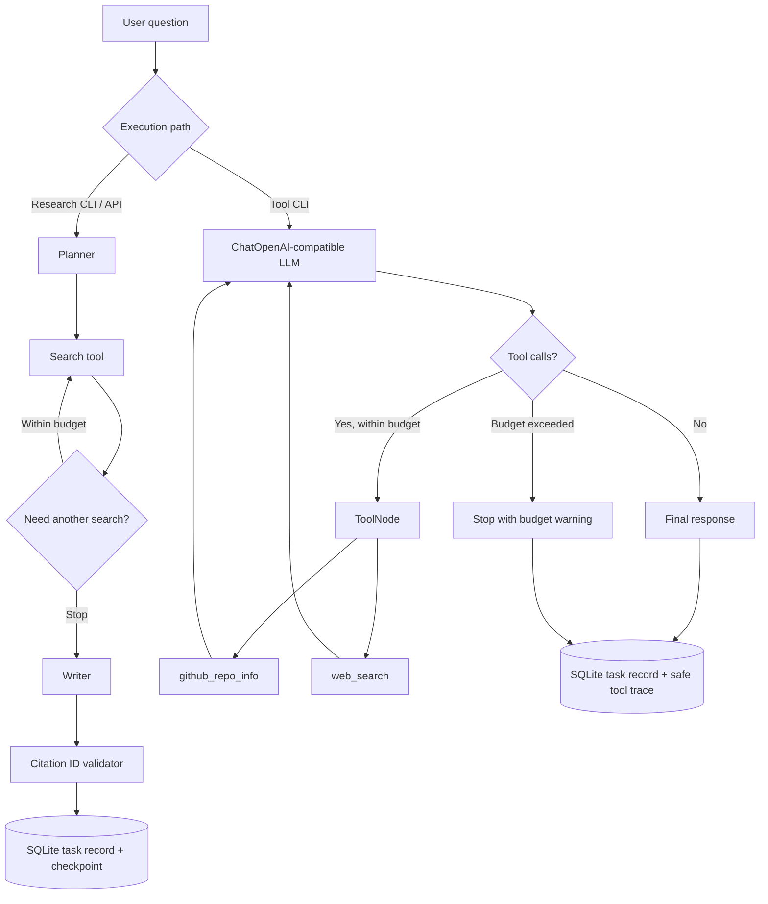

# ResearchFlow architecture / 架构

## Two independent execution paths

The research workflow and Tool Calling workflow are intentionally separate. Tool selection in `mock` is scripted. The live agent uses `model.bind_tools()` to let a real LLM choose tools, then LangGraph executes and observes the result.

## Key engineering decisions

| Decision | Benefit | Cost / remaining limitation |
|---|---|---|
| SQLite checkpointer and terminal task record | Recover completed/failed tasks by ID; preserve latest observed state | Local single-machine demonstration, not distributed queue |
| Tool budget | Avoid runaway tool loops and unexpected spending | A budgeted-out request cannot be answered with new evidence |
| Read-only, validated GitHub `owner/repo` input | Prevent arbitrary request destinations | Only repository metadata is accessible |
| Trace records names and statuses, not raw payloads | Lower risk of leaking provider keys, prompt content, retrieved secrets | Cannot replay exact tool arguments from stored traces |
| Offline tests and scripted mock eval | Deterministic CI with no model API cost | No measurement of live model answer quality |
| Shell > `.env` diagnostic | Explains confusing configuration overrides | Diagnostic is advisory; it does not change environment values |
| Optional `RESEARCHFLOW_HTTP_PROXY` | Model traffic can use local proxy without changing system proxy | Does not affect GitHub/Tavily; provider routing must be tested |

## Security boundaries

- Treat external tool output as untrusted. Prompt instructions in retrieved content must not be executed.
- Use `.env` locally. Rotate keys after accidental disclosure. CI includes no live API keys.
- `config_doctor` only prints credential presence; it does not log their values.
- The research report validator checks citation *identifiers*, not claim-level entailment.
- Do not expose the synchronous FastAPI endpoint to the public Internet without auth/rate limiting.

## Example observed live task

In one 2026-10-26 `qwen3.8-chat` test, the tool agent requested `github_repo_info(repository=langchain-ai/langgraph)`, observed a tool result, generated an answer, and saved a complete, non-synthetic trace. Observed token count and duration are single-run telemetry, **not aggregate benchmarks**.
